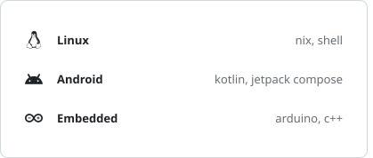
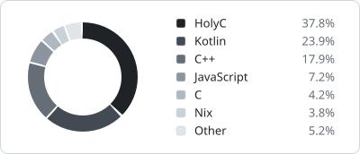

<a href="#readme"><picture><source media="(prefers-color-scheme: dark)" srcset="assets/hello-dark.svg"></picture></a>

<a href="#readme"><picture><source media="(prefers-color-scheme: dark)" srcset="assets/work-dark.svg"></picture></a>
<a href="#readme"><picture><source media="(prefers-color-scheme: dark)" srcset="assets/langs-dark.svg"></picture></a>
